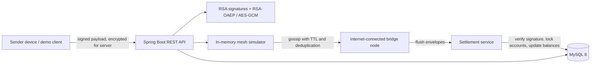

# UPI Offline Mesh

A Java 21 / Spring Boot 3 application that demonstrates signed, encrypted payment packets moving through an in-memory, store-and-forward mesh. Nodes without internet can gossip packets to a bridge node, which submits them for server-side verification and settlement.

This is a local development and simulation project. It is not a real UPI client, payment gateway, or bank integration.

## Architecture



## Payment flow

1. Register sender and receiver accounts. The sender account stores the sender's Base64 X.509 RSA public key.
2. The sender creates a payload containing a UUID packet ID, VPAs, amount, and timestamp. The payload's canonical fields are signed with the sender's private RSA key.
3. The server demo helper encrypts the signed JSON with a random AES-256-GCM key and wraps that AES key with the server's RSA-OAEP public key. A real sender application must keep its private key on the device.
4. The sender injects the envelope into a mesh node. The simulator identifies packets by ciphertext hash, tracks seen packets, and forwards them over bidirectional links while TTL remains.
5. An internet-connected bridge flushes held envelopes. The server decrypts, verifies the sender signature and packet constraints, then uses database transactions and pessimistic account locks to debit and credit the accounts.
6. Packet IDs and database uniqueness constraints provide idempotency; balances and transaction records are persisted in MySQL.

## Setup

Requirements: Java 21, Maven 3.9+, Node.js 20+, npm, and Docker with Docker Compose.

Start MySQL 8:

```sh
docker compose up -d
```

By default, the application connects to `jdbc:mysql://localhost:3306/upi_mesh` as `root` with the development password `root123`. Do not reuse these credentials outside local development.

Run the application:

```sh
mvn spring-boot:run
```

Check health:

```sh
curl http://localhost:8080/api/health
```

Expected response: `{"status":"UP"}`.

### React dashboard

The Vite dashboard runs separately from Spring Boot. With the API running, start it with:

```sh
cd frontend
npm install
npm run dev
```

Open the Vite URL shown in the terminal (typically `http://localhost:5173`). CORS is enabled for localhost and 127.0.0.1 origins. To point the dashboard at a different API URL, set `VITE_API_BASE_URL` before starting Vite.

The dashboard displays mesh nodes and links, supports adding nodes and connecting peers, creates demo accounts, builds and injects signed/encrypted payments, steps gossip rounds, flushes bridge nodes, and refreshes balances and transactions. Demo private signing keys are held only in the current page's memory and are lost on refresh; the demo key-generation endpoint is not suitable for production.

On Windows, after MySQL and frontend dependencies are ready, you can start the backend and frontend in separate PowerShell windows using:

```powershell
.\start-demo.ps1
```

If MySQL is listening on port 3307 instead of the Compose default 3306:

```powershell
.\start-demo.ps1 -MySqlPort 3307
```

Wait for Spring Boot to finish starting before using the dashboard. The API status indicator shows when the browser can reach it. The mesh itself is in-memory, so create nodes and links again after a backend restart.

Build the static dashboard bundle with:

```sh
cd frontend
npm run build
```

## API examples

All examples use `http://localhost:8080`. `demo.enabled=true` is set in the supplied development configuration; the `/api/demo/**` endpoints are for testing only.

### Health and server key

```sh
curl http://localhost:8080/api/health
curl http://localhost:8080/api/server/public-key
```

### Accounts

Create Alice with a public key generated by the demo helper:

```sh
curl -X POST http://localhost:8080/api/demo/keypair
```

Copy the returned `publicKey` into the account request:

```sh
curl -X POST http://localhost:8080/api/accounts \
  -H "Content-Type: application/json" \
  -d '{"vpa":"alice@upi","name":"Alice","initialBalance":1000.00,"publicKey":"<BASE64_PUBLIC_KEY>"}'

curl -X POST http://localhost:8080/api/accounts \
  -H "Content-Type: application/json" \
  -d '{"vpa":"bob@upi","name":"Bob","initialBalance":500.00}'

curl http://localhost:8080/api/accounts/alice@upi
```

Account creation requires a VPA in `name@bank` form, a nonblank name, and a nonnegative initial balance. Duplicate VPAs return `409 Conflict`.

### Build and ingest a payment directly

Use the sender's private key returned by `/api/demo/keypair` only in this local demo:

```sh
curl -X POST http://localhost:8080/api/demo/build-packet \
  -H "Content-Type: application/json" \
  -d '{"senderVpa":"alice@upi","receiverVpa":"bob@upi","amount":25.00,"senderPrivateKey":"<BASE64_PRIVATE_KEY>"}'
```

Pass the returned encrypted envelope to ingest or mesh send:

```sh
curl -X POST http://localhost:8080/api/payments/ingest \
  -H "Content-Type: application/json" \
  -d '{"encryptedKey":"<BASE64_ENCRYPTED_KEY>","iv":"<BASE64_IV>","ciphertext":"<BASE64_CIPHERTEXT>"}'

curl http://localhost:8080/api/transactions
```

The amount must be greater than zero and at most `100000.00`, have no more than two fractional digits, and sender/receiver must differ. Ingest is limited to 65,536 bytes and 60 requests per IP per 60 seconds by default; both settings are configurable with the `app.security.payment-ingest.*` properties.

### Mesh simulator

Create nodes, connect them, and inject the encrypted envelope returned above:

```sh
curl -X POST http://localhost:8080/api/mesh/nodes \
  -H "Content-Type: application/json" -d '{"nodeId":"phone","hasInternet":false}'
curl -X POST http://localhost:8080/api/mesh/nodes \
  -H "Content-Type: application/json" -d '{"nodeId":"relay","hasInternet":false}'
curl -X POST http://localhost:8080/api/mesh/nodes \
  -H "Content-Type: application/json" -d '{"nodeId":"bridge","hasInternet":true}'
curl -X POST http://localhost:8080/api/mesh/connect \
  -H "Content-Type: application/json" -d '{"nodeA":"phone","nodeB":"relay"}'
curl -X POST http://localhost:8080/api/mesh/connect \
  -H "Content-Type: application/json" -d '{"nodeA":"relay","nodeB":"bridge"}'
curl -X POST http://localhost:8080/api/mesh/send \
  -H "Content-Type: application/json" \
  -d '{"nodeId":"phone","ttl":2,"envelope":{"encryptedKey":"<BASE64_ENCRYPTED_KEY>","iv":"<BASE64_IV>","ciphertext":"<BASE64_CIPHERTEXT>"}}'

curl -X POST http://localhost:8080/api/mesh/gossip
curl -X POST http://localhost:8080/api/mesh/gossip
curl http://localhost:8080/api/mesh/state
curl -X POST http://localhost:8080/api/mesh/flush
curl http://localhost:8080/api/transactions
curl -X POST http://localhost:8080/api/mesh/reset
```

Each gossip call performs one round. The bridge flush submits the packets it holds; the mesh is in memory and is reset when the application restarts.

### Automated demos

`/api/demo/run` creates Alice and Bob, builds a five-node chain, sends a payment, gossips to the bridge, flushes it, and returns a step log and final balances:

```sh
curl -X POST http://localhost:8080/api/demo/run
```

The duplicate-upload demo shows idempotent settlement, and the tamper demo changes a packet in transit and shows rejection:

```sh
curl -X POST http://localhost:8080/api/demo/run-duplicate
curl -X POST http://localhost:8080/api/demo/run-tamper
```

The `/api/demo/keypair` response includes a private key to make local tests convenient. **Never expose this pattern in a real app or send a device private key to a server.**

## Tests

Run the unit and H2-backed integration tests:

```sh
mvn test
```

The MySQL end-to-end test uses Testcontainers and requires Docker to be available. It starts an isolated MySQL 8 container, invokes account, demo packet, mesh send/gossip/flush APIs, then checks persisted balances and transaction records. Testcontainers automatically skips that test when Docker is unavailable.

Run only the MySQL end-to-end test:

```sh
mvn -Dtest=MeshMySqlEndToEndIntegrationTest test
```

## Limitations

- **Clock skew:** packet validity relies on server/device timestamps. Packets older than 24 hours or more than 5 minutes in the future are rejected; real deployments need a deliberate clock synchronization and skew policy.
- **Key distribution and rotation:** public-key registration and trust, revocation, rotation, and recovery are not implemented. Demo keys are not a production key-management design.
- **Offline double-spend risk:** a device may create conflicting offline payments before the server sees them. Server-side balance locks prevent concurrent overspending during settlement, but cannot guarantee that all offline promises will be honored.
- **Spam and denial of service:** the ingest size cap and in-memory per-IP rate limiter are basic single-process controls. They are not distributed, persistent, or sufficient against a production-scale attack.
- **No real UPI or bank integration:** this project only simulates accounts and settlement in its database; it does not connect to UPI rails, banks, payment processors, or device hardware.
- **In-memory mesh:** nodes, links, packets, and deduplication state are lost on restart; transport, peer authentication, and durable offline storage are not implemented.
# upi-offline-mesh

# upi-offline-mesh

